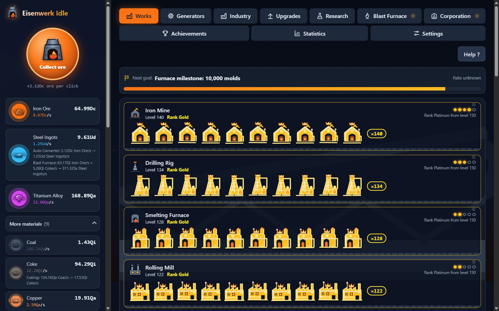
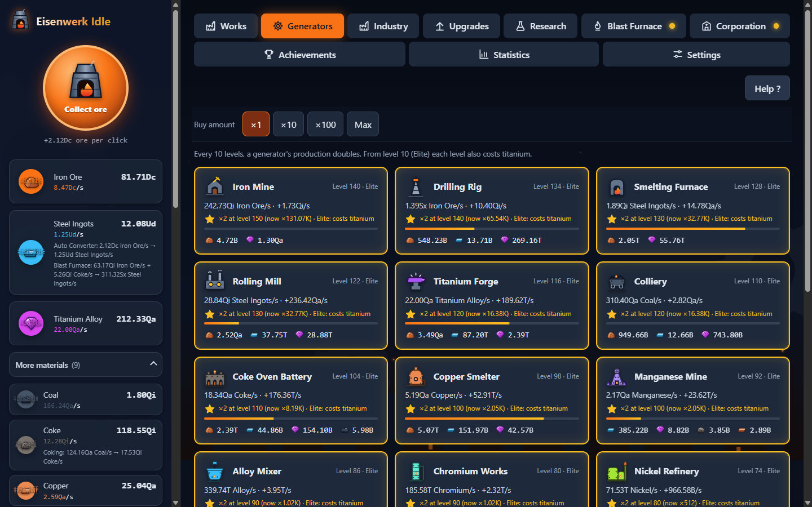
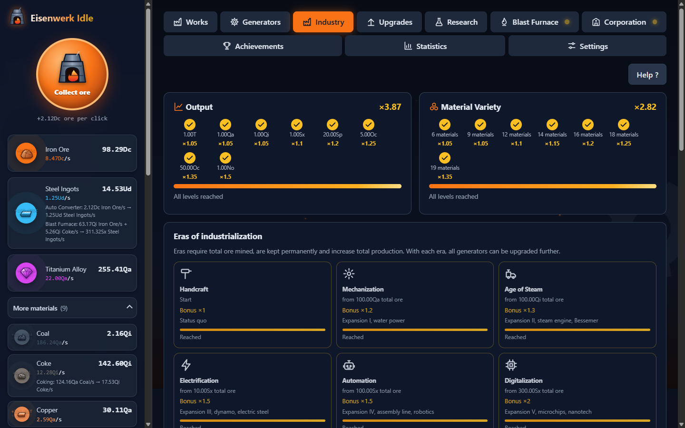
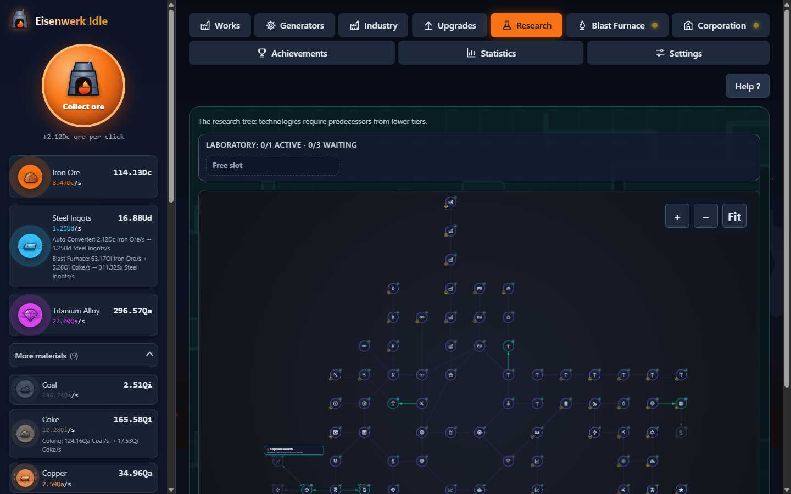
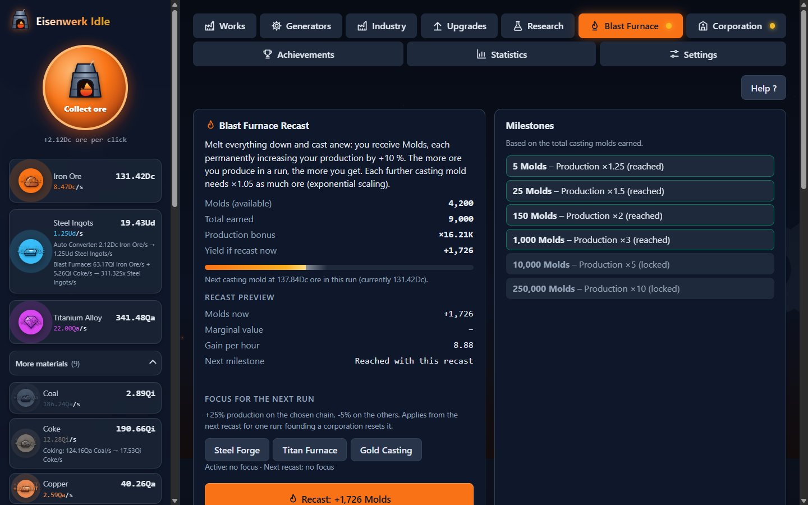
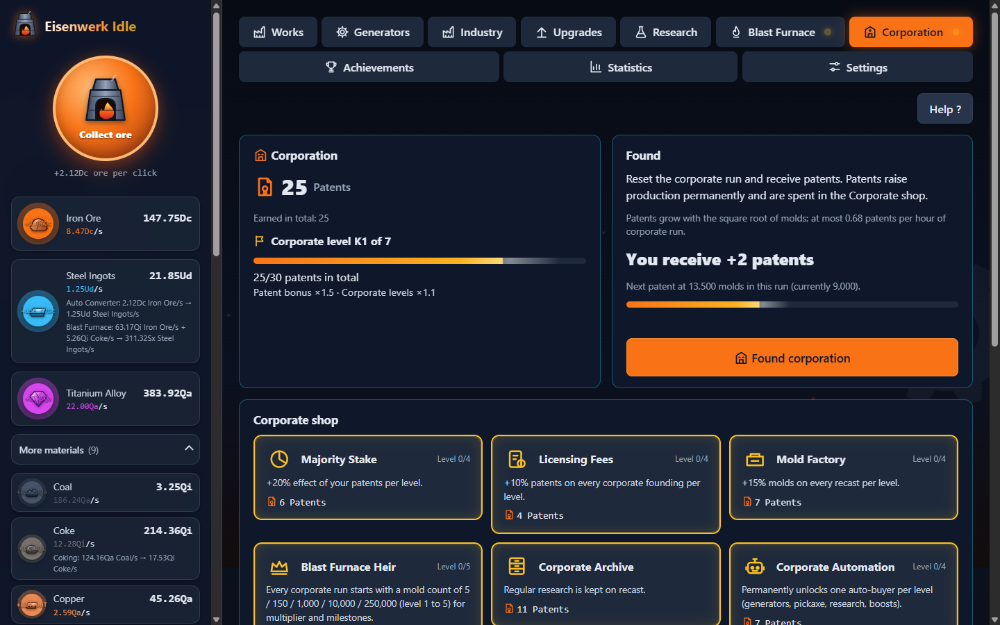
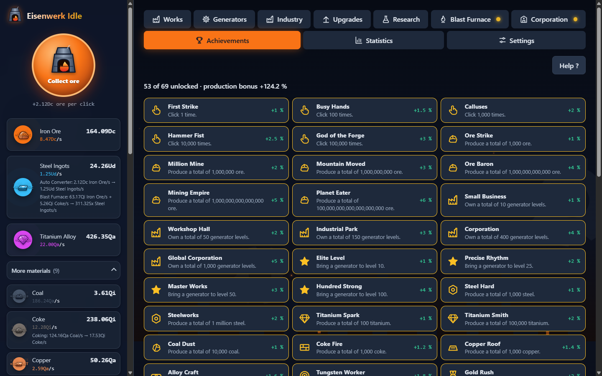
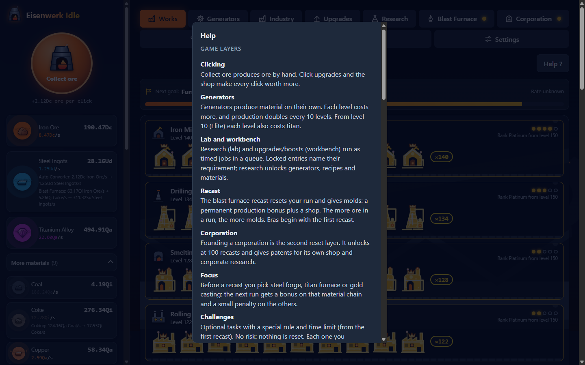

# Eisenwerk Idle

English | [Deutsch](README.md)

Browser idle game: ore becomes steel, titanium and gold. Vanilla ES modules, no build, no dependencies, German and English.



## Features

- **Generators and recipe chains**: 21 generators and 19 materials (coal, coke, copper, alloy, tungsten, gold and more). Recipes run automatically, for example coal to coke or ore and coke to steel. Production doubles every 10 levels, and from level 10 (Elite) each level also costs titanium. The factory hall shows generators in five evolution ranks (wood, iron, steel, titanium, gold).
- **Lab and workbench**: Research (lab) and boosts and click upgrades (workbench) run as timers. The cost is paid at once, the effect applies when the timer ends. Each queue has one active slot and three waiting slots.
- **Blast furnace recast (reset layer 1)**: Casting molds give a permanent production bonus. Milestones and a shop (auto-buyers, extra slots, time warp and more) add to it.
- **Focus**: Before each recast you choose Steel Forge, Titan Furnace or Gold Casting. The chosen chain gets +25 % production in the next run, the others -5 %.
- **Corporation (reset layer 2)**: From 100 recasts you can found a corporation and earn patents. Patents raise production, unlock corporation tiers K1 to K7 and are spent in the corporation shop. There are also 49 permanent corporation researches and four more material recipes.
- **Eras and industry**: From the first recast there are nine eras (Handcraft to Cosmic Forge) with a global bonus, new research and generator expansion. Two milestone bars (output, material variety) give further production bonuses.
- **Challenges**: From the first recast you can take on tasks with a special rule and a deadline (No Clicking, One Generator, Iron Deadline). Each completed challenge gives a one-time +3 % production.
- **Random events**: Every 8 to 15 minutes of active play an event appears in the factory: ore vein (click bonus), resource shortage (fix it with a click) or special order (deliver material for a production bonus).
- **Achievements and golden bars**: 69 achievements with production bonuses. Golden bars appear at random and give a timed buff when you click them or press G.
- **Offline progress**: On load, your absence is calculated at 60 % of the active yield, with a cap (base 8 h). From 60 s of absence a welcome dialog shows what you gained.
- **Daily bonus**: The first start on a new calendar day gives a Smelting Frenzy buff. Its duration grows in a streak up to day 7.
- **Help and glossary**: The `?` key or the "Hilfe ?" button opens an explanation of all game layers and terms.
- **Language, export and import**: German and English, export and import saves as Base64, three number formats, autosave. Older saves are migrated.
- **Multi-tab guard**: A second tab does not save, so it cannot overwrite your progress.

Scope: 125 researches (49 of them corporation research), 43 boosts, 10 click upgrades. The balance bot needs about 600 hours of active play to unlock everything. The numbers and how they were derived are in [docs/GAME-DESIGN.md](docs/GAME-DESIGN.md) and [docs/GAME-DESIGN-2.md](docs/GAME-DESIGN-2.md). These documents are in German.

## Preview

| | |
|---|---|
|  |  |
| Generators: purchase amount x1 to Max, level, Elite cost in titanium. | Industry: milestone bars and eras. |
|  |  |
| Research: tree with prerequisites, lab queue on top. | Blast furnace: recast preview, milestones, focus. |
|  |  |
| Corporation: patents, founding and corporation shop. | Achievements: condition and production bonus for each. |
|  | |
| Help dialog (key ?). | |

## Getting started

The game needs no build. ES modules do not run over `file://`, so serve the folder that contains `index.html` with any static web server and open `http://localhost:<port>`. One example:

```sh
npx serve .
```

## Project structure

```
index.html            Markup with CSP meta tag, loads js/main.js
css/styles.css
js/main.js            Bootstrap, game loop, autosave, multi-tab guard
js/boot-check.js      Error hint for file:// / load failures
js/data/              pure configuration: resources, generators, upgrades, recipes, research,
                      research-layout, eras, industry, corp, timers, achievements, prestige,
                      golden, challenges, events-random, help
js/core/              state, formulas, format, save (migration, export/import, offline),
                      events, multitab, i18n
js/i18n/              English texts (en-ui, en-data)
js/systems/           production, timers, prestige, achievements, golden, autobuyers, eras,
                      evolution, corp, industry, daily, events-random, challenges (no DOM)
js/ui/                render, sidebar, cards, queues, panels, industry, corp, corp-common, goals,
                      research-map, works, lab, tabs, assets, toast, effects, charts, settings,
                      static-i18n, dom, help, welcome, revent, challenges
assets/               sprites, icons, bg, preview.html
tests/                unit tests (node:test)
tools/                live.mjs, e2e.mjs, cdp.mjs, balance-sim.mjs, balance-full.mjs,
                      challenge-calib.mjs
docs/                 design, plan, specification, roadmap, screenshots
```

Logic (`core/`, `systems/`, `data/`) never touches the DOM. The UI talks to it through function calls and the event bus (`core/events.js`).

## Tests

```sh
node --test --test-timeout=900000 tests/*.test.mjs
```

Status: 588 unit tests pass, E2E 104 PASS (scenarios a to o). `tests/balance.test.mjs` simulates bot play time and is the longest test, hence the high timeout.

**E2E**: `tools/e2e.mjs` drives a visible Chrome through the DevTools protocol. Start the game server (for example on port 8080) and Chrome with `--remote-debugging-port=9222` and a tab on the game, then run `node tools/e2e.mjs --fast`. The run resets the save in the browser (a JSON backup is written first). Never run two in parallel. Options: `--only=c,d`, `--strict`, `--keep`.

**Balance**: `node tools/balance-full.mjs` plays both reset layers with a bot. The exit code is 0 if "everything unlocked" falls within the corridor of 504 to 700 h. Latest result: 602.3 h. The run takes about 13 minutes.

`tools/live.mjs` controls the same Chrome by hand (`eval`, `click`, `tab`, `shot`, `errors`, `check`).

## Security

- Content Security Policy via meta tag (`default-src 'none'`, scripts, styles and images only from `'self'`, `connect-src 'none'`). No inline scripts, no external resources.
- `window.__eisenwerk` (debug object) exists only on `localhost` and `127.0.0.1`.
- Imported data is validated against the game data and bounded.

## Documentation

All documents below are in German.

- [PROGRESS.md](PROGRESS.md): task, status and decisions of the development
- [docs/GAME-DESIGN.md](docs/GAME-DESIGN.md): resource chain, timers, evolution, balance
- [docs/GAME-DESIGN-2.md](docs/GAME-DESIGN-2.md): corporation founding, industry expansion, calibrated values, timeline
- [docs/PLAN-ausbau-3wochen.md](docs/PLAN-ausbau-3wochen.md): plan and decisions of the expansion
- [docs/SPEC-design-2.md](docs/SPEC-design-2.md): UI specification (corporation tab, industry bars)
- [docs/IDEEN-ROADMAP.md](docs/IDEEN-ROADMAP.md): ideas and outlook

## Roadmap

Ideas and planned extensions are listed in [docs/IDEEN-ROADMAP.md](docs/IDEEN-ROADMAP.md).
