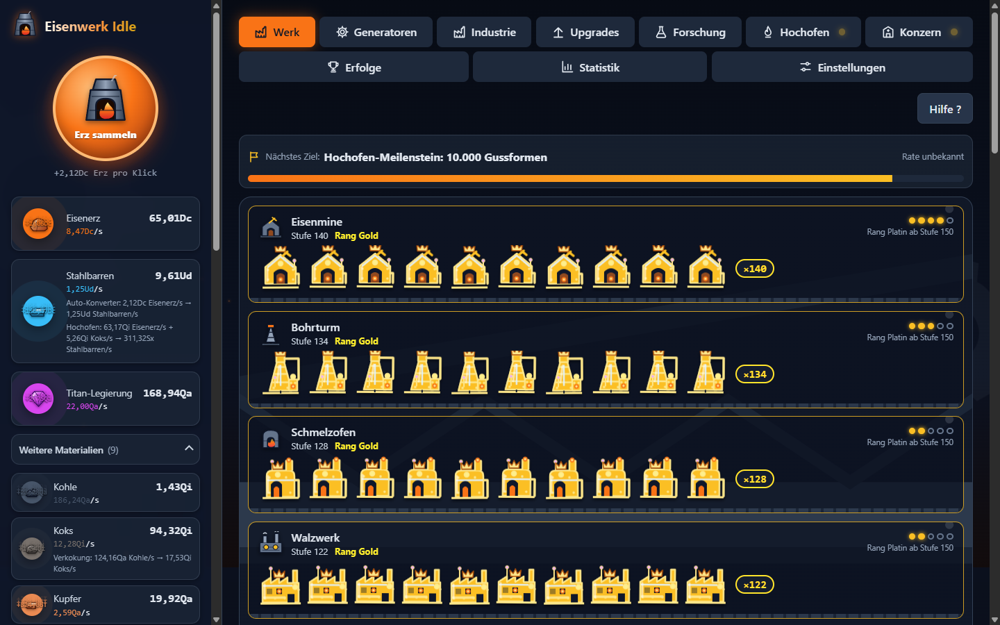
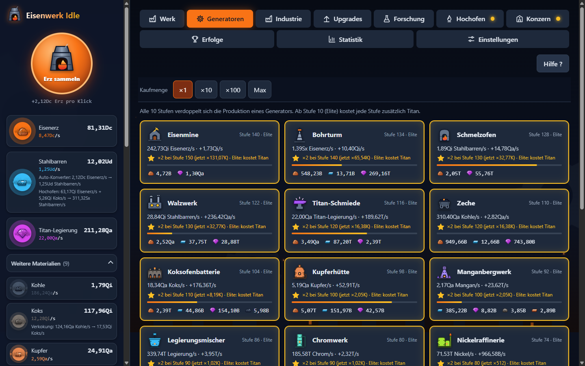
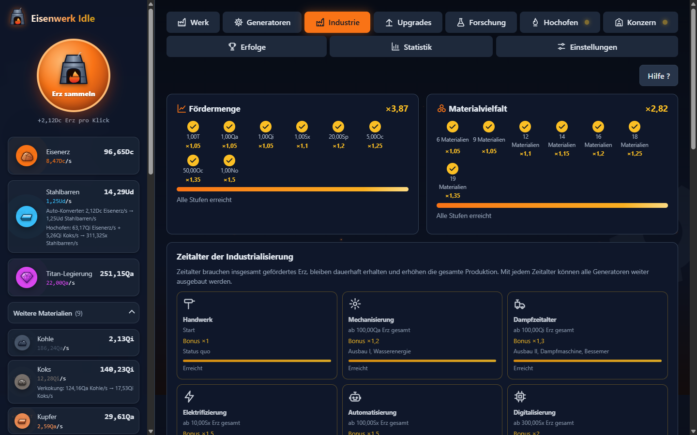
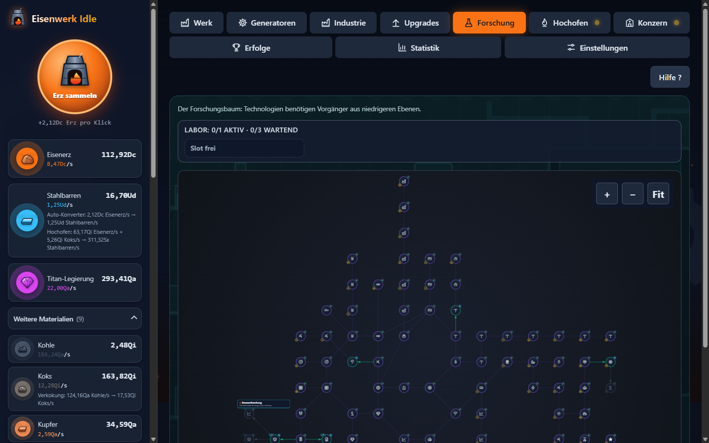
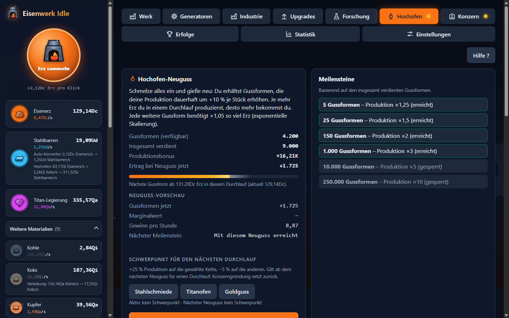
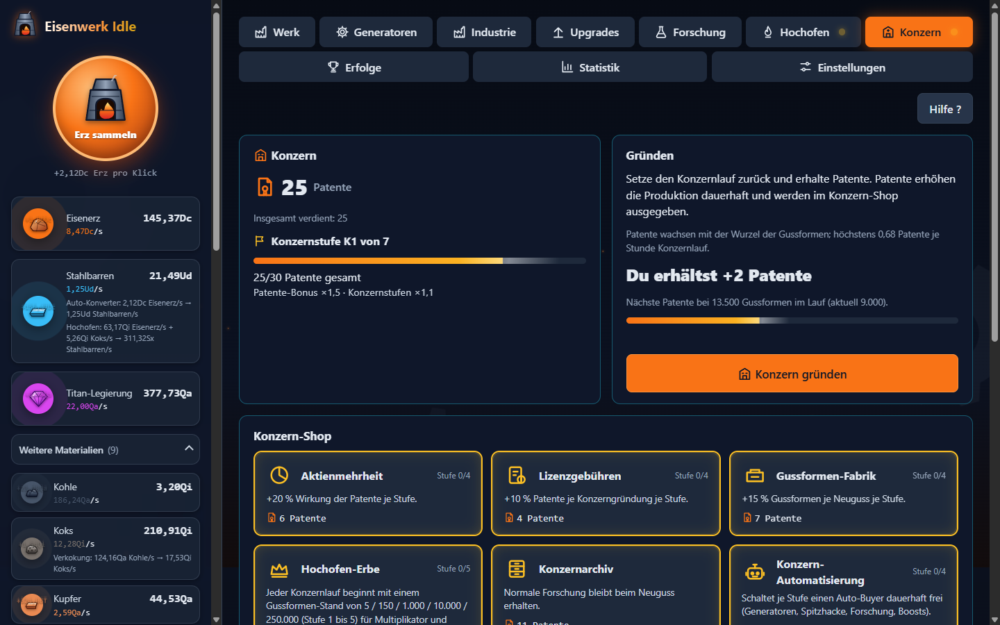
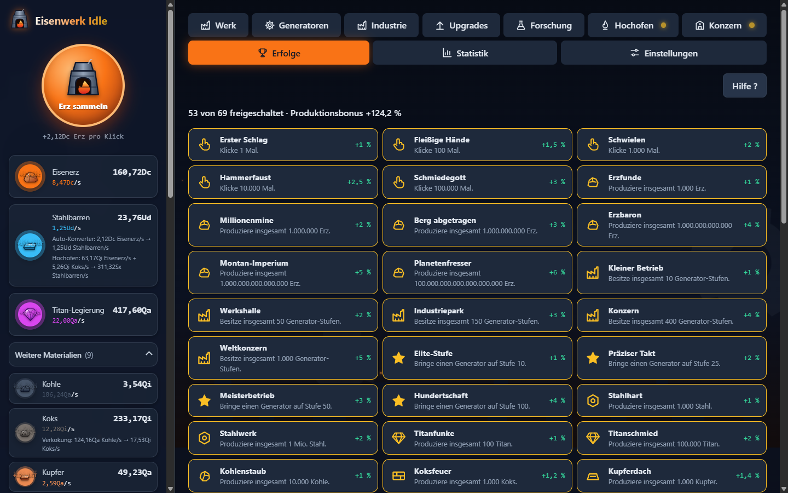
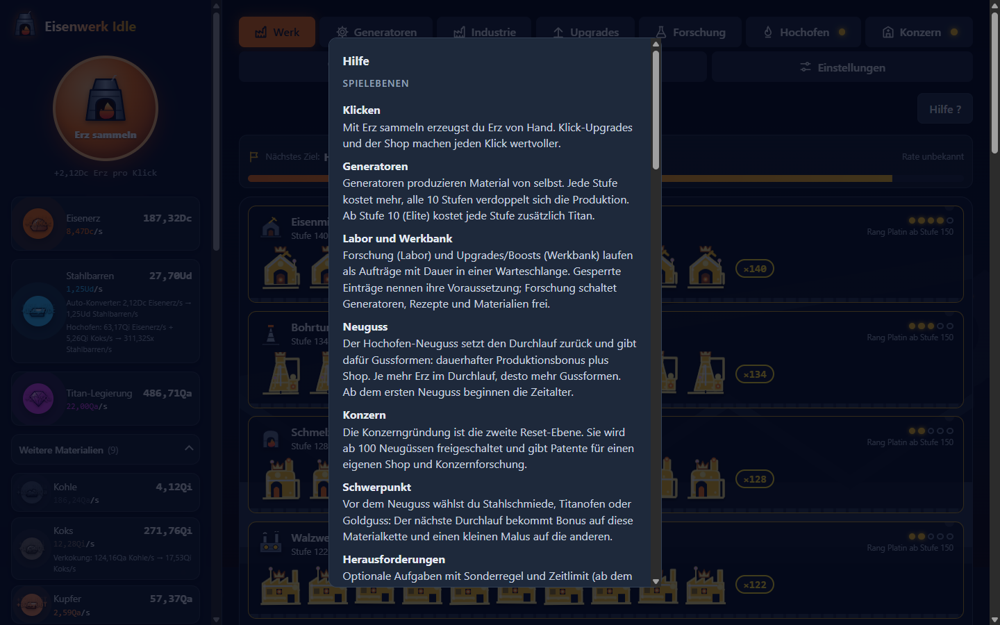

# Eisenwerk Idle

[English](README.en.md) | Deutsch

Idle-Spiel im Browser: Aus Erz wird Stahl, Titan und Gold. Vanilla ES-Module, kein Build, keine Abhängigkeiten, Deutsch und Englisch.

## Features

- **Generatoren und Rezeptketten**: 21 Generatoren und 19 Materialien (u. a. Kohle, Koks, Kupfer, Legierung, Wolfram, Gold). Rezepte laufen automatisch, z. B. Kohle zu Koks oder Erz und Koks zu Stahl. Alle 10 Stufen verdoppelt sich die Produktion, ab Stufe 10 (Elite) kostet jede Stufe zusätzlich Titan. Die Werkshalle zeigt die Generatoren in fünf Evolutionsrängen (Holz, Eisen, Stahl, Titan, Gold).
- **Labor und Werkbank**: Forschung (Labor) sowie Boosts und Klick-Upgrades (Werkbank) laufen als Timer. Die Kosten fallen sofort an, der Effekt greift nach Ablauf. Jede Warteschlange hat einen aktiven Slot und drei Warteplätze.
- **Hochofen-Neuguss (1. Reset-Ebene)**: Gussformen geben dauerhaft Produktionsbonus. Dazu kommen Meilensteine und ein Shop (u. a. Auto-Buyer, Zusatzplätze, Zeitraffer).
- **Schwerpunkt**: Vor jedem Neuguss wählst du Stahlschmiede, Titanofen oder Goldguss. Die gewählte Kette bekommt im nächsten Durchlauf +25 % Produktion, die anderen -5 %.
- **Konzern (2. Reset-Ebene)**: Ab 100 Neugüssen gründest du einen Konzern und erhältst Patente. Sie erhöhen die Produktion, schalten die Konzernstufen K1 bis K7 frei und werden im Konzern-Shop ausgegeben. Dazu kommen 49 dauerhafte Konzernforschungen und vier weitere Materialrezepte.
- **Zeitalter und Industrie**: Ab dem 1. Neuguss gibt es neun Zeitalter (Handwerk bis Kosmische Schmiede) mit globalem Bonus, neuen Forschungen und Generator-Ausbau. Zwei Meilenstein-Leisten (Fördermenge, Materialvielfalt) geben weitere Produktionsboni.
- **Herausforderungen**: Ab dem 1. Neuguss gibt es Aufgaben mit Sonderregel und Frist (Ohne Klicken, Ein Generator, Eiserne Frist). Jede geschaffte Herausforderung gibt einmalig +3 % Produktion.
- **Zufallsereignisse**: Alle 8 bis 15 Minuten aktiver Spielzeit erscheint ein Ereignis im Werk: Erzader (Klick-Bonus), Rohstoffengpass (per Klick beheben) oder Sonderauftrag (Material liefern für einen Produktionsbonus).
- **Erfolge und goldene Barren**: 69 Erfolge mit Produktionsbonus. Goldene Barren erscheinen zufällig und geben per Klick oder Taste G einen Zeitbuff.
- **Offline-Fortschritt**: Beim Laden wird die Abwesenheit nachgerechnet, mit 60 % des Aktiv-Ertrags und einer Kappe (Basis 8 h). Ein Willkommen-Dialog zeigt ab 60 s Abwesenheit, was du gewonnen hast.
- **Tagesbonus**: Der erste Start an einem neuen Kalendertag gibt einen Schmelzrausch-Buff, dessen Dauer in einer Serie bis Tag 7 wächst.
- **Hilfe und Glossar**: Die Taste `?` oder der Knopf "Hilfe ?" öffnet eine Erklärung aller Spielebenen und Begriffe.
- **Sprache, Export und Import**: Deutsch und Englisch, Spielstand als Base64 exportieren und importieren, drei Zahlenformate, Autosave. Ältere Spielstände werden migriert.
- **Mehr-Tab-Schutz**: Ein zweiter Tab speichert nicht und überschreibt den Fortschritt nicht.

Umfang: 125 Forschungen (davon 49 Konzernforschung), 43 Boosts, 10 Klick-Upgrades. Der Balance-Bot braucht rund 600 Stunden aktive Spielzeit bis alles freigeschaltet ist. Die Zahlen und ihre Herleitung stehen in [docs/GAME-DESIGN.md](docs/GAME-DESIGN.md).

## Vorschau

| | |
|---|---|
|  |  |
| Generatoren: Kaufmenge x1 bis Max, Stufe, Elite-Kosten in Titan. | Industrie: Meilenstein-Leisten und Zeitalter. |
|  |  |
| Forschung: Baum mit Vorgängern, Labor-Warteschlange oben. | Hochofen: Neuguss-Vorschau, Meilensteine, Schwerpunkt. |
|  |  |
| Konzern: Patente, Gründung und Konzern-Shop. | Erfolge: Bedingung und Produktionsbonus je Erfolg. |
|  | |
| Hilfe-Dialog (Taste ?). | |
